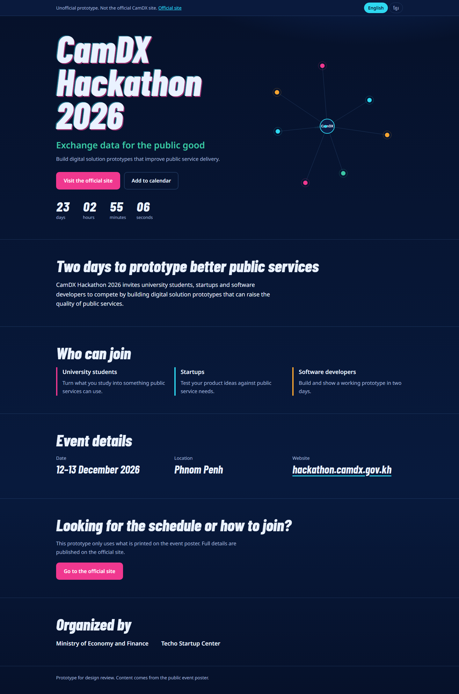

# CamDX Hackathon 2026

> Unofficial prototype landing page for **CamDX Hackathon 2026** — 12–13 December 2026, Phnom Penh.
> The official event site is [hackathon.camdx.gov.kh](https://hackathon.camdx.gov.kh).

[](https://github.com/loading-dev-20/CamDXClone/actions/workflows/ci.yml)
[](https://vercel.com/new/clone?repository-url=https://github.com/loading-dev-20/CamDXClone)

[](https://github.com/loading-dev-20/CamDXClone)

A fast, zero-dependency static site with:

- **Bilingual UI** — English and Khmer, persisted in `localStorage`
- **Live countdown** — computed from a single event configuration
- **Add to calendar** — generates a standards-compliant all-day `.ics` file
- **Canvas animation** — an accessible data-exchange visual that respects `prefers-reduced-motion`
- **Responsive layout** — one page that works from phones to large screens
- **Deploy-ready** — no build step, custom 404, security headers, and cache rules for Vercel

## Project structure

```text
.
├── .github/
│   └── workflows/ci.yml       # Syntax checks on pushes and pull requests
├── assets/
│   ├── css/
│   │   └── styles.css         # Design tokens, layout, components, responsive rules
│   ├── img/
│   │   ├── favicon.svg
│   │   └── social-preview.png # 1200×630 Open Graph / Twitter image
│   └── js/
│       ├── config.js          # Event dates, links, storage key, ICS settings
│       ├── i18n.js            # Language state, DOM translation, persistence
│       ├── locales/
│       │   ├── en.js
│       │   └── km.js
│       ├── countdown.js       # Countdown and live/ended states
│       ├── calendar.js        # RFC 5545 calendar file generation
│       ├── animation.js       # Canvas data-exchange animation
│       └── main.js            # Application entry point
├── docs/
│   └── preview.png            # README screenshot (not deployed)
├── scripts/
│   ├── dev-server.mjs         # Zero-dependency local server for `npm run dev`
│   └── social-preview.html    # Source for the Open Graph image (not deployed)
├── 404.html
├── index.html
├── package.json
├── robots.txt
├── site.webmanifest
└── vercel.json                # Redirects, security headers, caching
```

The site uses native ES modules. There is **no bundler, framework, or production
dependency** — what you see in the repository is what Vercel serves.

## Run locally

You need [Node.js](https://nodejs.org/) 18 or newer. There is no project
install or build step.

```bash
npm run dev
```

Open <http://localhost:3000>. The bundled `scripts/dev-server.mjs` uses only
Node's standard library. Any other static server also works, for example:

```bash
python -m http.server 3000
```

To use another port, set `PORT`:

```bash
PORT=4000 npm run dev         # macOS / Linux
$env:PORT=4000; npm run dev   # PowerShell
```

> **Why a server?** ES modules do not load from `file://` URLs in browsers.
> Opening `index.html` directly will render the page but skip the JavaScript.
> Vercel and the commands above serve it over HTTP, so everything works.

### Checks

```bash
npm run check
```

This runs `node --check` on every JavaScript module. The same command runs in
GitHub Actions on pushes to `main` and on pull requests.

## Deploy to Vercel

### Option A — Git integration (recommended)

1. Push the repository to GitHub (see below).
2. Go to [vercel.com/new](https://vercel.com/new) and import the repository.
3. Use these project settings:
   - **Framework Preset:** `Other`
   - **Build Command:** leave empty
   - **Output Directory:** leave empty (the repository root is the site)
   - **Install Command:** leave empty
4. Click **Deploy**.

Every push to `main` becomes a production deployment. Pull requests and other
branches get their own preview URLs automatically.

### Option B — Vercel CLI

```bash
npx vercel          # preview deployment
npx vercel --prod   # production deployment
```

The first run asks you to log in and confirm the project name. The included
`vercel.json` is picked up automatically.

### After the first deployment

1. Add the production URL near the top of this README.
2. Open `index.html` and update the social metadata with absolute URLs so link
   previews work everywhere:

   ```html
   <meta property="og:url" content="https://your-project.vercel.app/">
   <meta property="og:image" content="https://your-project.vercel.app/assets/img/social-preview.png">
   <meta name="twitter:image" content="https://your-project.vercel.app/assets/img/social-preview.png">
   ```

3. Optional: add a custom domain in **Vercel → Project → Settings → Domains**.

`vercel.json` already adds a permanent redirect from the old single-file URL
(`/camdx-hackathon-2026.html`) to `/`, so existing links keep working.

## Push to GitHub

The repository is already connected to `origin`:

```bash
git remote -v
# origin  https://github.com/loading-dev-20/CamDXClone.git (fetch)
# origin  https://github.com/loading-dev-20/CamDXClone.git (push)
```

Commit and push the restructured site:

```bash
git add .
git commit -m "chore: restructure static site for Vercel"
git push origin main
```

If you would rather rename the repository, do it in **GitHub → Settings →
General → Repository name** and update the remote URL:

```bash
git remote set-url origin https://github.com/<user>/<new-name>.git
```

Remember to update the CI badge and repository URL in `package.json` if the
repository name changes.

## Customize the content

| What | Where |
| --- | --- |
| Event dates, location, official URL, ICS filename | `assets/js/config.js` |
| English copy | `assets/js/locales/en.js` and `index.html` |
| Khmer copy | `assets/js/locales/km.js` |
| Colors, fonts, spacing, layout | `assets/css/styles.css` (`:root` tokens) |
| Social preview image | `scripts/social-preview.html` → `assets/img/social-preview.png` |

The visible text in `index.html` is the English fallback used by search engines
and visitors without JavaScript. When you change English copy, update both
`index.html` and `assets/js/locales/en.js` so the page stays consistent.

### Regenerate the social preview

`scripts/social-preview.html` is a 1200×630 design source. Open it in a browser
and capture the viewport, or use headless Edge/Chrome:

```powershell
& "C:\Program Files (x86)\Microsoft\Edge\Application\msedge.exe" `
  --headless=new --disable-gpu --hide-scrollbars `
  --window-size=1200,630 --virtual-time-budget=8000 `
  --screenshot="assets\img\social-preview.png" `
  "file:///D:/All_my_Project/CamDX/scripts/social-preview.html"
```

After deploying, use an absolute URL for `og:image` as described above.

## Notes

- The page is an **unofficial prototype**. Content comes from the public event
  poster. CamDX and the organizer names and marks belong to their respective
  owners.
- No open-source license is included. Add one if you want to allow others to
  reuse the code.
- The only third-party request is Google Fonts. If you need a fully self-hosted
  build, download the font files and update the `@font-face`/`link` tags.
